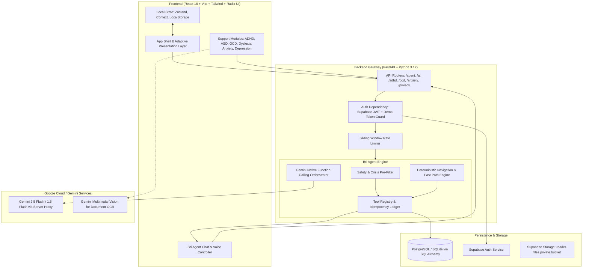

# NEUROBRIDGE — ARCHITECTURE DOCUMENTATION

---

## 1. Frontend Architecture
- **Adaptive Shell:** `AppLayout.jsx` dynamically adapts navigation items based on active user features (`featureRegistry.js`) and persona role (`user`, `guardian`, `support`).
- **Bri Agent Widget:** Mounted globally on regular user routes. Connects to backend via Server-Sent Events (SSE) `/api/agent/chat/stream` for real-time progress and tool card delivery.
- **Voice Integration:** `useAgentVoice.js` uses Web Speech API for low-latency hands-free speech input, directly piped into the agent orchestrator.
- **Support Modules:** Encapsulated workspaces with specialized tools (Task Breakdown, Focus Timer, ERP Hierarchy, SUDS Monitor, Dyslexia Reader).

---

## 2. Backend Architecture
- **FastAPI Core:** `backend/main.py` serves REST and streaming endpoints under CORS security policies.
- **Agent Orchestrator (`agent_service.py`):**
  1. **Deterministic Safety Pre-filter:** Immediate non-LLM detection of crisis/harm phrases.
  2. **Fast-Path Engine:** Direct tool execution for zero-latency deterministic commands (e.g. "show my OCD progress", "pause timer").
  3. **Intent-Scoped Context:** Dynamically loads only relevant module schemas into prompt to preserve tokens and prevent hallucination.
  4. **Multi-round Tool Calling:** Invokes Gemini tool declarations up to `AGENT_MAX_STEPS`.
  5. **Confirmation Policy:** Distinguishes `READ`, `WRITE_LOW`, and `WRITE_CONFIRM`. Dangerous or irreversible writes halt and await explicit user confirmation.
- **Server-Side AI Proxy (`ai_proxy_router.py`):** Authenticated, rate-limited gateway for client features requiring one-shot Gemini completions or multimodal OCR, keeping the `GEMINI_API_KEY` strictly on the server.

---

## 3. Data & Storage
- **Relational Tables:**
  - `agent_conversations`, `agent_messages`, `agent_action_logs`, `agent_executions`
  - `adhd_task_breakdowns`, `adhd_focus_sessions`
  - `ocd_hierarchies`, `ocd_tasks`, `erp_sessions`, `ocd_journal_entries`
  - `anxiety_grounding_sessions`
  - `asd_social_scenarios`, `asd_routine_steps`
  - `agent_learnings`, `intervention_outcomes` (closed-loop personalization)
- **Supabase Storage:** User reading uploads stored in private `reader-files` bucket with signed URL access.

---

## 4. Security, Isolation & Privacy
- **Zero Cross-User Leaks:** Every SQL query explicitly scopes to `CurrentUser.id`.
- **Demo Mode Isolation:** Pseudo-tokens (`demo:nb-user-042:<session_id>`) create ephemeral sandboxes preventing demo visitors from colliding with real users.
- **Data Minimization:** No user names, emails, or ABHA identifiers are forwarded in Gemini prompts.
- **Right to Erasure:** `/api/privacy/data` cascades through all user records for complete data purging.

## Google Cloud layer
Cloud Run (FastAPI) + Firebase Hosting (SPA, `/api/**` rewrite). Vertex AI / Gemini via `google-genai`, Firestore + Cloud Storage via `firebase_service.py`, observability via `google_cloud.py`. Details: `GOOGLE_ARCHITECTURE.md`.
