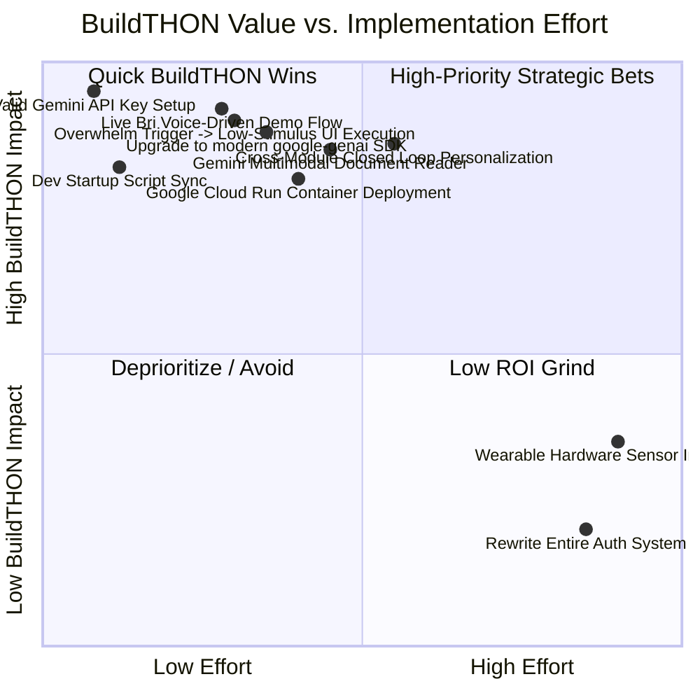

# NEUROBRIDGE — BUILDTHON ROADMAP & EXECUTION PLAN

> **Focus:** Polished, technically impressive, deeply integrated Google AI startup product for Google Startup BuildTHON.

---

## Strategic Priority Matrix

---

## Phase Breakdown

### Phase 1: Engine Validation & Google AI Unblocking (Immediate)
1. **Unblock Gemini API Connection:** Replace expired/invalid `GEMINI_API_KEY` in `.env` with an active Google AI Studio key.
2. **Synchronize Development Scripts:** Update `start-dev.ps1` and `start-dev.sh` to run the true FastAPI backend (`python -m uvicorn backend.main:app --port 5000`) and point to Vite port 8080.
3. **Upgrade Google GenAI Client:** Transition from deprecated `google-generativeai` to `google-genai` across `ai_service.py` and `agent_service.py`.

### Phase 2: Compelling BuildTHON Demo Storyline (The "Hero" Journey)
- **Problem Statement:** A student with ADHD & sensory anxiety faces an overwhelming 10-page syllabus or assignment.
- **Step 1 (Multimodal Perception):** User uploads syllabus/document; Gemini Multimodal parses and extracts the hardest section into plain dyslexia-friendly language.
- **Step 2 (Voice + Bri Agent):** User says via voice: *"I'm completely paralyzed by this deadline."*
- **Step 3 (Reasoning & Adaptive Action):**
  - Bri detects high cognitive overwhelm.
  - Automatically triggers **Low-Stimulation Mode** (muted colors, removed sidebar distractions).
  - Creates a **Smart Task Breakdown** (3 micro-steps, starting with just 1 easy 5-minute action).
  - Asks permission to initiate a 10-minute focus timer.
- **Step 4 (Execution):** User confirms; focus timer starts in real-time, state updates in ADHD workspace.
- **Step 5 (Closed Learning Loop):** Upon completion, Reflection Engine records user success at 10-minute duration; updates future recommendations.

### Phase 3: Google Technology Deepening
- **Gemini 2.5 Flash Function Calling:** Optimize system prompt and tool definitions for low latency and zero hallucinations.
- **Google Cloud Run:** Package FastAPI backend + Vite static frontend into a dual/monolith container for instant zero-hassle cloud deployment.
- **Cloud Firestore (Optional Hybrid):** Sync user session memories with Firestore for scalable cross-device state.

### Phase 4: Polish & Pitch Readiness
- **Accessibility Check:** Keyboard navigation, WCAG AA contrast, screen reader aria tags across all cards.
- **Offline / Degraded Graceful Handling:** Clear visual feedback if network or Gemini quota fails.
- **30-Second Elevator Demo Video & Deck:** Clear differentiation from generic chatbots.

## Google demo script (2026-11-20)
1. Continue with Google → 2. Upload syllabus on Task Breakdown → plan with 5-minute first steps → approve → 3. Ask Bri "what's due for my essay class?" → 4. Start the focus session Bri suggests → 5. Show Cloud Logging, the Monitoring latency metric, the BigQuery event counts and Analytics DebugView.
