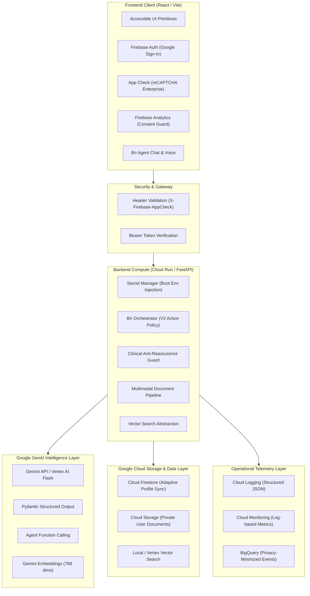

# NEUROBRIDGE — GOOGLE INTEGRATION ARCHITECTURE

> **Authoritative Architectural Specification**  
> **Updated:** 2026-11-20  
> **Philosophy:** Deep Google Cloud & Ecosystem integration with zero architectural clutter, user isolation, and clinical safety.

---

## 1. High-Level System Architecture

NeuroBridge weaves 14 distinct Google technologies into an integrated accessibility platform:

---

## 2. Component Integration Details

### A. Intelligence & Reasoning (Gemini & Vertex AI)
- **Primary AI Service (`backend/services/google_ai_service.py`):**
  - Built exclusively on the official `google-genai` SDK.
  - Automatically selects `Gemini API` (with API Key) during local development, and `Vertex AI` (with IAM Application Default Credentials) when deployed to Cloud Run.
  - Features an active fallback chain: `gemini-3.5-flash-lite` -> `gemini-3.1-flash-lite` -> `gemini-3.5-flash` -> `gemini-3.8-flash`.
  - Recovers gracefully from transient 503 (Unavailable), 504 (Deadline Exceeded), and HTTP disconnects.
- **Clinical Safety Guard:**
  - Strict anti-reassurance regex filter (`contains_reassurance()`) preventing harmful OCD reassurance-seeking loops in ERP exercises.

### B. Security & Identity (Firebase Auth & App Check)
- **Unified Identity (`backend/auth.py`):**
  - Verifies Firebase JWTs cryptographically using `firebase_admin.auth.verify_id_token()`.
  - Normalizes identities to `firebase:<uid>`.
  - Prevents cross-tenant data access by scoping all SQL queries, Firestore documents, and Cloud Storage objects to `current_user.id`.
- **App Check:**
  - Guards expensive AI endpoints against automated abuse using reCAPTCHA Enterprise attestations.
  - Three operational modes: `off` (local dev), `monitor` (telemetry only), `enforce` (strict 401 rejection).

### C. Storage & Synced Profiles (Firestore & Cloud Storage)
- **Division of Responsibility:**
  - **SQL Database (SQLite / Postgres):** Relational system of record for task steps, exposure hierarchies, and audit records.
  - **Cloud Firestore:** Document store for cross-device adaptive profiles (`users/<uid>/adaptive_profile`) and document catalog mirrors.
  - **Cloud Storage:** Private storage for academic syllabi, assignments, and PDFs under `gs://<bucket>/users/<uid>/documents/...`. Accessible exclusively through short-lived (10-minute) V4 signed URLs.

### D. Semantic Memory & Vector Search (Integrations 08 & 09)
- **Embedding Generation:**
  - Generates 768-dimensional dense vectors using `gemini-embedding-001`.
- **Retrieval Abstraction (`backend/services/vector_search_service.py`):**
  - `VectorSearchProvider` interface decoupling retrieval logic from physical infrastructure.
  - `LocalExactVectorSearch`: High-speed, zero-cost exact cosine similarity scan bounded to the user's database records. Default for local development and personal use.
  - `VertexAIVectorSearch`: Scales to millions of documents on Google Cloud Matching Engine with metadata filtering `{"namespace": "user_id", "allow": [user_id]}`. Automatically falls back to local exact search if cloud endpoints fail.

### E. Telemetry & Analytics (Logging, Monitoring, BigQuery)
- **Privacy Contract:**
  - Absolute data minimization.
  - **Cloud Logging:** Emits structured JSON with severity, trace correlation, and sanitized latency/model metadata.
  - **Cloud Monitoring:** Log-based metrics filter on `nb_event` to monitor AI call latency, error rates, and throughput.
  - **BigQuery:** Asynchronous queue worker thread batches privacy-safe product events into a daily partitioned `product_events` table. No user IDs, emails, notes, or conversation text are ever ingested.
